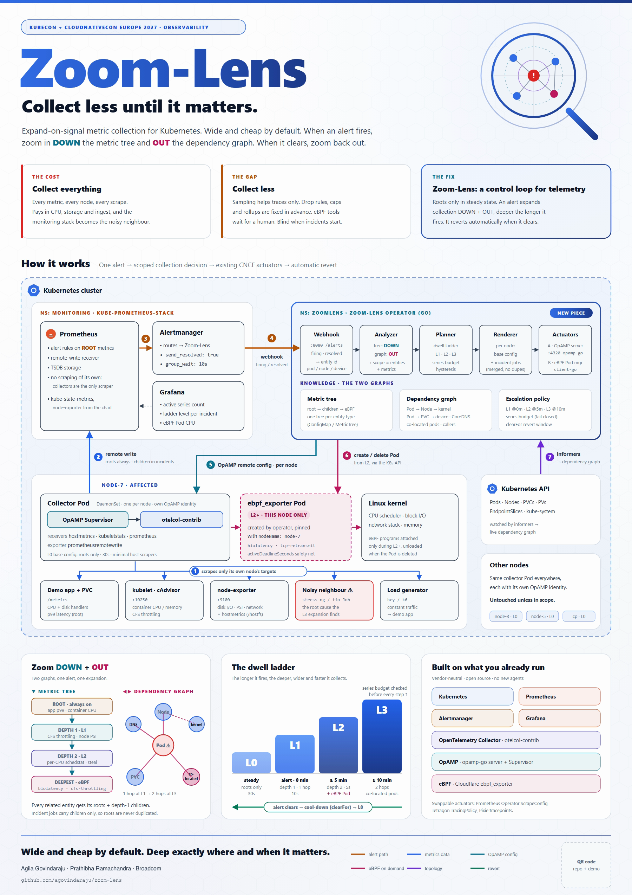

<div align="center">

# 🔍 Zoom-Lens

**Collect less until it matters.**

*Expand-on-signal metric collection for Kubernetes: wide and cheap by default, deep exactly where
and when an incident happens.*


[Why](#-the-problem) · [How it works](#-how-it-works) · [Components](#-components) ·
[Quick start](#-quick-start) · [Knowledge](#-the-knowledge-layer) · [Docs](#-documentation) · [Poster](docs/poster/zoom-lens-poster-light.png)

</div>

---

## 🎯 The problem

Kubernetes observability makes you choose between two bad options:

| Option | What happens |
|---|---|
| **Collect everything** | Every metric from every node on every scrape. You pay in CPU, storage and ingest, the monitoring stack becomes a noisy neighbour itself, and the useful signal is buried in data nobody reads. |
| **Collect less** | Trace sampling only helps traces. Metric drop rules, cardinality caps and rollups are fixed in advance. On-demand eBPF tools (Pixie, Tetragon) can go deep, but only after a human picks the target and writes the probe. **When an incident starts, the detail you need isn't there.** |

The ecosystem already has **reducers** (sampling, caps, rollups) and **actuators** (OpAMP,
Prometheus per-target scrape config, eBPF tools). What's missing is **the controller that joins
them**: something that decides *where* and *what* to collect when an incident starts, and undoes
it afterwards.

## 💡 The idea

Zoom-Lens treats the telemetry pipeline as the managed element of a **closed control loop**:

1. **Steady state:** each entity (pod, node, volume…) collects only a few **root** metrics at a
   relaxed interval.
2. **Alert fires on a root metric:** the Zoom-Lens operator expands collection
   - **DOWN** a *metric tree* (root → finer child metrics → kernel-level eBPF metrics), and
   - **OUT** the *Kubernetes dependency graph* (pod → node → volume/device → co-located pods).
3. **Alert persists:** a **dwell ladder** increases depth, hops and scrape rate over time, while
   staying inside a **series budget**.
4. **Alert clears:** after a cool-down window, everything **reverts** to the baseline
   automatically.

> Telemetry should work like a zoom lens: wide and cheap by default, zooming in along the
> dependency graph when something breaks, and zooming back out when it clears.

## 🏗️ How it works



```
Prometheus rule (roots) ─▶ Alertmanager ─webhook─▶ Zoom-Lens operator
                                                    │  dwell ladder + metric tree + dependency graph
                                    OpAMP (per node)│                 │ create/delete pod (per node)
                                                    ▼                 ▼
                     OpAMP Supervisor + otelcol-contrib (DaemonSet)   ebpf_exporter (only L2+)
                                                    │
                                        remote write ▼
                                             Prometheus ─▶ Grafana
```

### The dwell ladder

| Level | When | What is collected on the affected scope |
|---|---|---|
| **L0** | steady state | Root metrics only, 30s, minimal host scrapers. No eBPF. |
| **L1** | alert fires (0 min) | Depth-1 children, 1 hop in the dependency graph, 10s |
| **L2** | still firing ≥ 5 min | Depth-2 children, 5s, **`ebpf_exporter` Pod started on the affected node only** |
| **L3** | still firing ≥ 10 min | 2 hops, e.g. co-located pods, which is where the noisy neighbour shows up |
| **revert** | resolved for `clearFor` | Base config pushed back, eBPF Pods deleted |

Before each step the operator checks a series budget and **fails closed**: if the step would
exceed the budget, the incident stays at its current level.

## 🧩 Components

| Component | Role in Zoom-Lens |
|---|---|
| **Zoom-Lens operator** (Go, *new*) | The brain. Receives alerts, walks the metric tree and dependency graph, runs the dwell ladder, renders per-node collector configs and drives the actuators. Webhook `:8080`, OpAMP server `:4320`. |
| **OpenTelemetry Collector** (`otelcol-contrib`) | The only scraper. Runs as a DaemonSet, one per node, with `hostmetrics`, `kubeletstats` and `prometheus` receivers, and remote-writes to Prometheus. |
| **OpAMP** (`opamp-go` server + OpAMP Supervisor) | The control channel. Each node's collector connects with its own identity, so "expand to node-7" means "push a new config to node-7's collector". The other nodes are untouched. |
| **Prometheus** | Storage (remote-write receiver) and evaluation of alert rules on **root** metrics. |
| **Alertmanager** | Sends `firing` and `resolved` webhooks to the operator (`send_resolved: true`). |
| **eBPF, via Cloudflare `ebpf_exporter`** | Kernel metrics (`biolatency`, `tcp-retransmit`, `cfs-throttling`…). Started as a Pod pinned to the affected node at L2 and deleted on revert. Creating the Pod loads the programs; deleting it unloads them. |
| **Kubernetes API** (`client-go` informers) | Pods, Nodes, PVCs, PVs and EndpointSlices feed the live dependency graph. |
| **Grafana** | Dashboard for active series count, ladder level per incident and eBPF Pod CPU. |
| **Knowledge** | What to collect and where: metric trees, relations and an entity graph as `zoomlens.dev/v1alpha1` resources, plus the root alert rules. See [The knowledge layer](#-the-knowledge-layer). |

Everything outside the operator is an existing open-source CNCF project. The actuators can be
swapped: Prometheus Operator `ScrapeConfig`, Tetragon `TracingPolicy` or Pixie tracepoints all fit
the same loop.

## 🚀 Quick start

**Prerequisites:** Docker, `kubectl`, `helm`, and either `kind` or any cluster you already have
(Rancher Desktop, minikube, a real cluster). Go 1.25 is only needed to run the tests. eBPF
scenarios need Linux ≥ 5.15 with BTF on the nodes.

```bash
# 1. Deploy everything (kube-prometheus-stack, collectors, operator, knowledge, demo app)
./scripts/deploy-all.sh --create-kind          # new local kind cluster
./scripts/deploy-all.sh                        # or the current kubectl context

# 2. Start a noisy-neighbour scenario
./scripts/scenario.sh cpu start                # Scenario A: CPU
./scripts/scenario.sh disk start               # Scenario B: disk, with eBPF at L2

# 3. Watch Zoom-Lens zoom in
./scripts/status.sh --watch                    # incidents, overlays, eBPF pods, agents
make grafana                                   # http://localhost:3000  (admin / zoomlens)

# 4. Stop the fault and watch it zoom back out
./scripts/scenario.sh cpu stop

# 5. Clean up
./scripts/teardown.sh
```

Step-by-step install, configuration and troubleshooting: **[docs/DEPLOYMENT.md](docs/DEPLOYMENT.md)**.
A shorter walkthrough with the commands and timings to expect: **[docs/QUICKSTART.md](docs/QUICKSTART.md)**.
Run `make help` for every target.

### Demo scenarios

| Scenario | Fault | What you see |
|---|---|---|
| **A: CPU noisy neighbour** | `stress-ng` on the app's node | App p99 alert → CFS throttling + node PSI (L1) → per-CPU schedstat (L2) → co-located pods (L3) → `stress-ng` found → revert |
| **B: disk noisy neighbour** | `fio` on the same node/disk | Write-latency alert → PVC and device latency (L1) → **`biolatency` eBPF Pod on that node only** (L2) → `fio` Job found → eBPF Pod deleted |

## 🧠 The knowledge layer

The operator does not hard-code which metrics to expand. That is data, shipped in [`knowledge/`](knowledge/README.md)
as plain Kubernetes resources, so you can read it, diff it and extend it:

| Resource | Answers |
|---|---|
| `MetricTreePack` | For one metric source: which root metrics are always on, and which finer metrics sit below each root at depth 1, 2, 3. |
| `MetricRelations` | Which roots in different sources describe the same condition, and which eBPF programs to start for a root. |
| `EntityGraph` | Which Kubernetes entities depend on which (Pod → Node, Pod → PVC → PV, Pod → CoreDNS, apiserver → etcd, …), gated by problem domain. |

The ladder timings are separate operator configuration: [`deploy/operator/ladder.yaml`](deploy/operator/ladder.yaml).
Root alert rules (standard Prometheus rules labelled `zoomlens_root`) are in
[`knowledge/generated/prometheusrule.yaml`](knowledge/generated/prometheusrule.yaml).

The curated set covers node-exporter, OpenTelemetry hostmetrics, cAdvisor, kubelet, kube-state-metrics,
kube-apiserver, etcd, scheduler, controller-manager, kube-proxy, CoreDNS and eBPF, with optional
containerd, CSI, Cilium and Calico packs. Browse every tree in [`knowledge/generated/TREE.md`](knowledge/generated/TREE.md).
To add your own metric, root, rule or application pack, see
[docs/knowledge-guide/11-maintaining-and-extending.md](docs/knowledge-guide/11-maintaining-and-extending.md).

## 📁 Repository layout

```
cmd/            operator (zoomlens) and demo workload (demo-app)
internal/       alerts · incident (dwell ladder) · plan · render · opamp · ebpf · budget · knowledge
api/v1alpha1/   knowledge API types (CRDs are generated into deploy/crds)
knowledge/      metric trees, relations, entity graph and root alert rules
hack/mkg/       validator and generator for knowledge/
deploy/         kind, monitoring, collector, operator, demo, grafana manifests
scripts/        deploy steps, scenarios, status, teardown
docs/           architecture, quick start, deployment, knowledge, development, poster
```

## 📚 Documentation

| Document | What's in it |
|---|---|
| [docs/ARCHITECTURE.md](docs/ARCHITECTURE.md) | One-page design |
| [docs/QUICKSTART.md](docs/QUICKSTART.md) | Run it locally, with expected timings and the checks that prove each step |
| [docs/DEPLOYMENT.md](docs/DEPLOYMENT.md) | Install, configure, troubleshoot |
| [docs/KNOWLEDGE.md](docs/KNOWLEDGE.md) | How the operator uses the knowledge, the interfaces, how to plug in your own |
| [docs/knowledge-guide/](docs/knowledge-guide/README.md) | Guided explanation of the knowledge resources and how to extend them |
| [knowledge/README.md](knowledge/README.md) | The curated Kubernetes knowledge: coverage, files, validation |
| [docs/DEVELOPMENT.md](docs/DEVELOPMENT.md) | Status, tests, code layout, pinned versions |
| [docs/ROADMAP.md](docs/ROADMAP.md) | What is done and what is next |
| [docs/poster/](docs/poster) | The project poster (light and dark) |

## 🗺️ Status and roadmap

Zoom-Lens is a **proof of concept**. It was run end to end on a single-node Kubernetes cluster
(Rancher Desktop, k3s): alert → OpAMP overlay → eBPF pod on the affected node → automatic revert.
It has not been run on a large multi-node cluster yet. See [docs/ROADMAP.md](docs/ROADMAP.md).

## 🤝 Contributing

Issues, discussion and pull requests are welcome. Please read [CONTRIBUTING.md](CONTRIBUTING.md) and run
`make check` before opening a pull request.

## 🎤 Talk

*Collect Less Until It Matters: Zoom-Lens Telemetry for Kubernetes*, proposed for KubeCon +
CloudNativeCon Europe 2027 (Observability track). By Agila Govindaraju and Prathibha Ramachandra.

## 📄 License

To be added before the first release (see the note in [CONTRIBUTING.md](CONTRIBUTING.md)).
